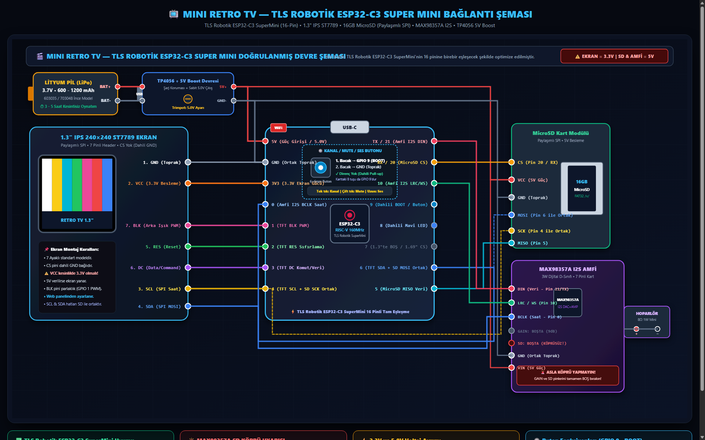

# 🔌 Mini Retro TV — Tam Pin Bağlantı Şemaları

> 💡 **Ana Donanım:** **TLS Robotik ESP32-C3 SuperMini (Lehimsiz, 16-Pin)**  
> **Ekran:** 1.3" IPS ST7789 (7-Pin, 240×240) veya 1.69" IPS ST7789 (8-Pin, 240×280)  
> **Depolama:** MicroSD Kart Modülü (Paylaşımlı Donanımsal SPI)  
> **Ses:** MAX98357A 3W I2S Dijital Ses Amfisi + 8Ω 1W Mini Hoparlör  
> **Güç:** TP4056 Type-C Korumalı Şarj + 5.0V Boost Devresi + 3.7V LiPo Pil  

---

## 🌟 TLS Robotik ESP32-C3 SuperMini Görsel Devre Şeması

Bu bağlantı TLS Robotik ESP32-C3 SuperMini'nin 16 pinlik kompakt pin dizilimine tam uyarlanmıştır. SPI veriyolu (Saat ve Veri hatları) ekran ile MicroSD kart arasında paylaştırılmıştır.

<p align="center">
  
</p>

---

## 📌 ESP32-C3 SuperMini (16-Pin) Fiziksel Pin Haritası

```
                  ┌───────────┐
                  │   USB-C   │
                  │ [B]   [R] │  (B = GPIO 9 BOOT, R = RESET)
     5V (5.0V)  [1]           [16]  GPIO 21 (TX / Amfi DIN)
     GND        [2]           [15]  GPIO 20 (RX / MicroSD CS)
     3V3        [3]           [14]  GPIO 10 (Amfi LRC / WS)
  GPIO 0        [4]           [13]  GPIO 9  (BOOT / Kasa Butonu)
  GPIO 1        [5]           [12]  GPIO 8  (Dahili Mavi LED)
  GPIO 2        [6]           [11]  GPIO 7  (1.3"te BOŞ / 1.69" CS)
  GPIO 3        [7]           [10]  GPIO 6  (SPI MOSI / SDA Ortak)
  GPIO 4        [8]           [9]   GPIO 5  (MicroSD MISO)
                  └───────────┘
```

---

### A. 1.3" IPS 240×240 ST7789 Ekran (7-Pin) ↔ ESP32-C3 (Sol Sıra)

| # | Ekran Pini (1.3") | ESP32-C3 Pini | Header Konumu | Görevi / Açıklama |
|:---:|:---|:---|:---|:---|
| **1** | **GND** | **GND** | Sol Sıra 2 | Ortak Toprak |
| **2** | **VCC** | **3.3V (3V3)** | Sol Sıra 3 | ⚠️ **Sadece 3.3V! Asla 5V vermeyin!** |
| **3** | **SCL (CLK)** | **GPIO 4** | Sol Sıra 8 | Donanımsal SPI Saat Sinyali (SD ile ortak) |
| **4** | **SDA (MOSI)**| **GPIO 6** | Sağ Sıra 10 | Donanımsal SPI Veri Hattı (SD ile ortak) |
| **5** | **RES (RST)** | **GPIO 2** | Sol Sıra 6 | Donanımsal Ekran Sıfırlama |
| **6** | **DC** | **GPIO 3** | Sol Sıra 7 | Veri / Komut Seçimi (Data/Command) |
| **7** | **BLK (BL)** | **GPIO 1** | Sol Sıra 5 | PWM Arka Aydınlatma & Parlaklık Kontrolü |
| — | *(CS Pini)* | *(Dahili GND)* | — | 1.3" 7 pinli ekranda CS pini yoktur (kart içinde GND'ye bağlıdır). |

*(Not: Eğer 8 pinli 1.69" ekran kullanıyorsanız, ekrandaki CS pinini **GPIO 7**'ye bağlayın).*

---

### B. MicroSD Kart Modülü ↔ ESP32-C3 (Paylaşımlı SPI)

> ⚠️ **KRİTİK GÜÇ NOTU:** Arduino MicroSD modülleri üzerinde dahili `AMS1117-3.3V` regülatör bulunur. Modülün `VCC` pinini **5V** hattına bağlayın.

| MicroSD Modülü | ESP32-C3 Pini | Header Konumu | Görevi / Açıklama |
| :--- | :--- | :--- | :--- |
| **VCC** | **5V** | Sol Sıra 1 | 5V Güç Beslemesi (Modül üstü regülatör için) |
| **GND** | **GND** | Sol Sıra 2 | Ortak Toprak |
| **CS** | **GPIO 20 (RX)**| Sağ Sıra 15 | Bağımsız MicroSD Kart Seçim Pini |
| **MOSI** | **GPIO 6** | Sağ Sıra 10 | Donanımsal SPI Veri Gönderme (Ekran SDA ile ortak) |
| **SCK (CLK)**| **GPIO 4** | Sol Sıra 8 | Donanımsal SPI Saat Sinyali (Ekran SCL ile ortak) |
| **MISO** | **GPIO 5** | Sağ Sıra 9 | Donanımsal SPI Veri Okuma Hattı |

---

### C. MAX98357A I2S 3W Ses Amfisi (7-Pin Header) + Hoparlör ↔ ESP32-C3

Fiziksel kart üzerindeki 7 pinin sırasıyla bağlantı durumu:

| # | MAX98357A Pini | ESP32-C3 Pini | Durum | Açıklama / Görevi |
|:---:|:---|:---|:---:|:---|
| **1** | **LRC** | **GPIO 10** | Bağlı | I2S Word Select / Sol-Sağ Kanal Sinyali |
| **2** | **BCLK** | **GPIO 0** | Bağlı | I2S Bit Clock (Ses Saat Sinyali) |
| **3** | **DIN** | **GPIO 21 (TX)** | Bağlı | I2S Data In (Sayısal Ses Verisi) |
| **4** | **GAIN** | *(Boş)* | **BOŞ** | **Bağlanmaz!** Boş bırakıldığında varsayılan 9 dB temiz kazançta çalışır. |
| **5** | **SD** | *(Boş)* | **BOŞ (ASLA KÖPRÜ YAPMAYIN!)** | 🚨 **ASLA KÖPRÜ YAPMAYIN!** Hemen yanındaki 6. pin GND, 7. pin ise 5V'tur. Araya köprü teli takmaya çalışmak 5V ile GND'yi kısa devre yaptırıp **kartı yakabilir ve pili patlatabilir!** MAX98357A çipi SD pini boş bırakıldığında zaten varsayılan olarak AÇIKTIR ve stereo sesi mono olarak hoparlöre verir `(L+R)/2`. |
| **6** | **GND** | **GND** | Bağlı | Ortak Toprak Hattı |
| **7** | **VIN** | **5V** | Bağlı | 5V Güç Beslemesi (Hoparlörden 3W tam ve net ses almak için) |
| — | **`+` / `−`** | **Hoparlör** | Bağlı | 8Ω 1W mini hoparlör uçlarına lehimlenir (+ Kırmızı, − Siyah) |

---

### D. Çok Fonksiyonlu Kontrol Butonu (`GPIO 9` / Dahili BOOT & Harici Buton)

ESP32-C3 SuperMini üzerindeki dahili **BOOT** butonu `GPIO 9` pinine bağlıdır. Kasanın tavanındaki 3.6 mm delik için harici buton bağlantısı:

| Buton Bacağı | ESP32-C3 Bağlantısı | Notlar |
|:---:|:---|:---|
| **1. Bacak** | **GPIO 9 (BOOT Pini)** | Sinyal hattı (Sağ Sıra 13) |
| **2. Bacak** | **GND (Ortak Toprak)** | Toprak hattı (Sol Sıra 2) |

* **Direnç Gerekmez:** Yazılımda ESP32-C3'ün dahili çekme direnci (`pinMode(PIN_BUTTON, INPUT_PULLUP)`) aktiftir.
* **3D Buton Pimi (`button_cap.stl`):** Baskı tablasından çıkan T-şekilli şapkalı buton pimi, kasanın üstündeki delikten içeri bırakılır. Alttaki mikro butona parmakla mekanik basım sağlar.
* **Buton Fonksiyonları:**
  * **Tek Kısa Basış:** Sonraki video / kanala geçiş (`nextChannel()`).
  * **Çift Tıklama (Hızlı 2 Basış):** **SESİ AÇ / KAPAT (MUTE TOGGLE)!** Ekranda anında `[ 🔇 SES KAPALI (MUTE) ]` veya `[ 🔊 SES: %... ]` OSD'si çıkar.
  * **Uzun Basış (> 1.2 saniye):** Ses kademesi döngüsü (`%0` $\rightarrow$ `%25` $\rightarrow$ `%50` $\rightarrow$ `%75` $\rightarrow$ `%100`).

---

### E. TP4056 + 5V Boost Ayarlı Voltaj Yükseltici & Li-Po Pil

> ⚠️ **HAYATİ AYAR UYARISI:** Kart fabrikadan 9V - 12V ayarlı gelebilir. **ESP32'ye bağlamadan önce** pili karta lehimleyin, bir multimetre ile `VOUT+` ve `VOUT-` uçlarını ölçerek üzerindeki mavi trimpot vidasını çevirip voltajı **TAM 5.0V** seviyesine sabitleyin!

| Modül Pini | Bağlantı Hedefi | Kablo Rengi / Voltaj | Açıklama / Not |
| :--- | :--- | :--- | :--- |
| **BAT +** | 3.7V Li-Po Pil (+) | Kırmızı (3.7V Nominal) | 603035 / 703048 Lityum Polimer Pil Artı Ucu |
| **BAT -** | 3.7V Li-Po Pil (-) | Siyah (GND) | Lityum Pil Eksi Ucu |
| **VOUT +** | ESP32-C3 **5V** Pini | Kırmızı (**5.0V Sabit**) | Yükseltilmiş ve filtrelenmiş kararlı 5V güç |
| **VOUT -** | ESP32-C3 **GND** Pini | Siyah (GND) | Ana sistem toprak hattı |
| **Type-C** | 5V Telefon Şarj Kablosu | 5V DC Giriş | Pili şarj eder (Kırmızı: Şarjda, Mavi: Dolu) |
