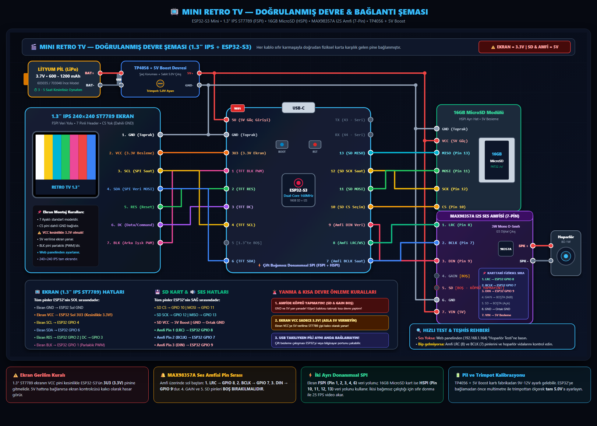
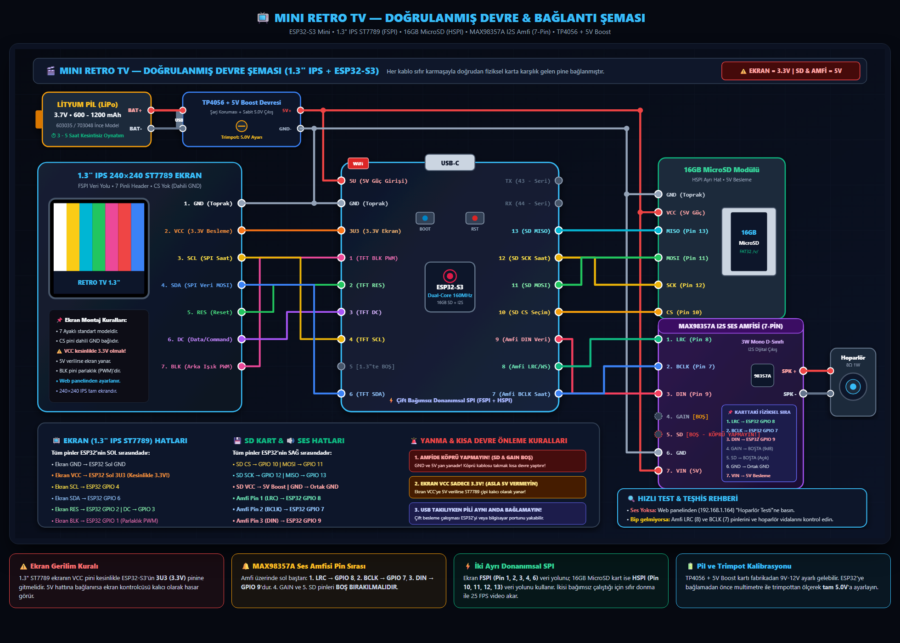
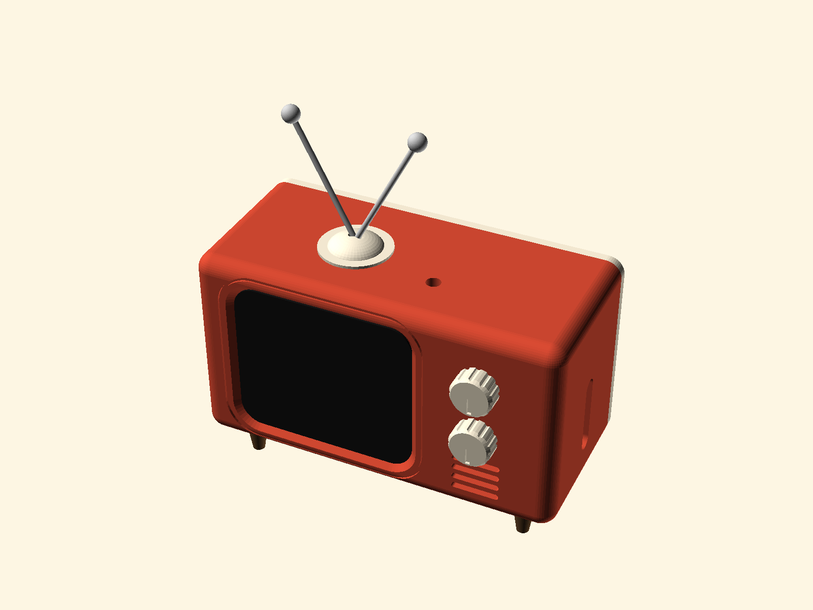
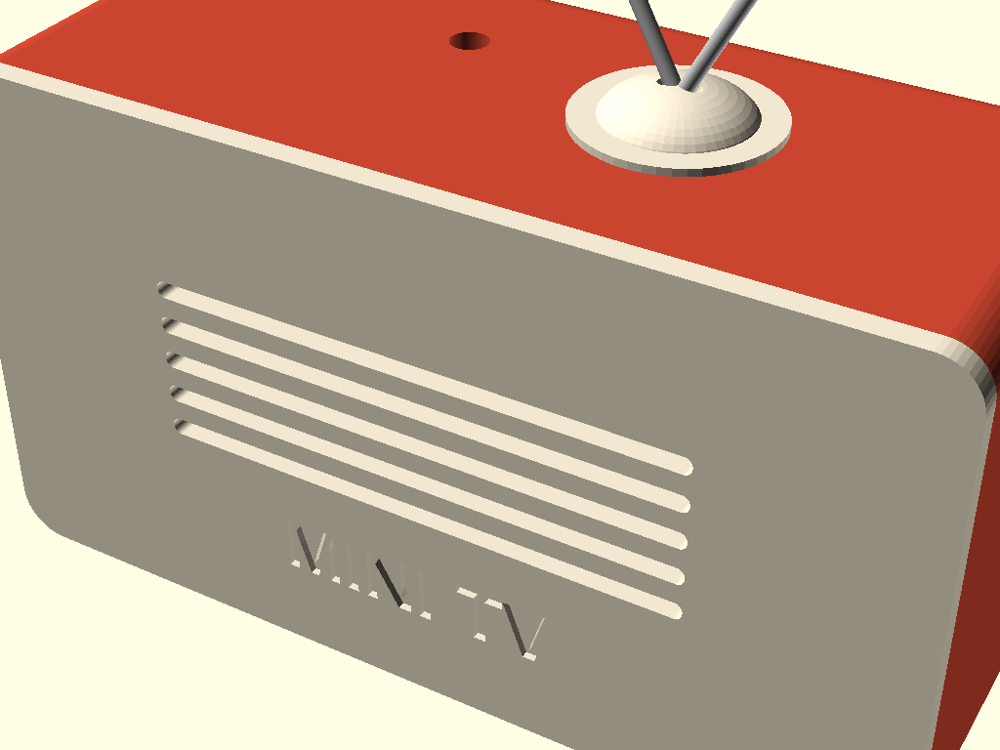
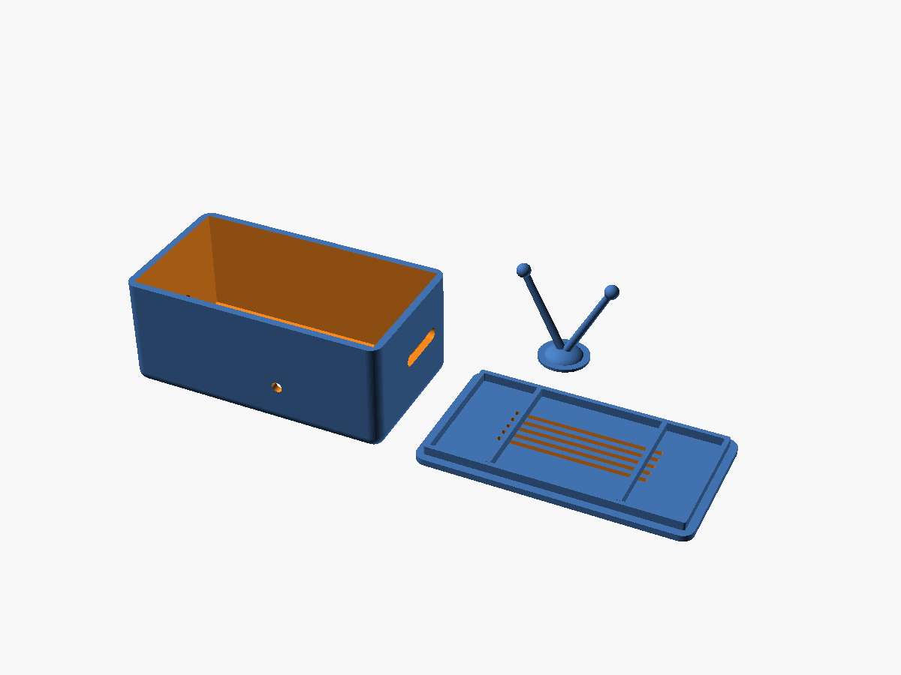

# 📺 Mini Retro TV — Montaj ve Çizim Rehberi

Bu rehberde **Voltaj 1.69" 240×280 ST7789 IPS oval ekran**, ESP32-S3 / C3, 16GB MicroSD, MAX98357A 7-pin I2S amfi, hoparlör ve voltaj yükseltici şarj kartını içeren **nihai tam donanım montajının** detaylı çizimleri ve 3D kasa yerleşimleri yer almaktadır.

---

## 1. ⚡ Voltaj 1.69" ST7789 IPS (8-Pin) + ESP32-S3 Mini Montajı

Kablo geçişlerini kolaylaştırmak ve karmaşayı önlemek için ekranın tüm pinleri **ESP32-S3'ün sol kenarındaki pin sırasına (GPIO 1 – 9)** birebir 1'e 1 eşleştirilmiştir:

| # | Ekran Pini (1.69" IPS) | ESP32-S3 Mini Pini | Kablo | Açıklama / Görevi |
|:---:|:---|:---|:---:|:---|
| **1** | **GND** | **GND** | Siyah | Ortak toprak hattı |
| **2** | **VCC** | **3V3 (3.3V)** | Kırmızı | ⚠️ **Sadece 3.3V'a bağlayın. Asla 5V vermeyin!** |
| **3** | **SCL** | **GPIO 4** | Turuncu | SPI Clock (Saat) |
| **4** | **SDA** | **GPIO 6** | Mavi | SPI MOSI (Görüntü verisi) |
| **5** | **RES** | **GPIO 2** | Yeşil | Reset pini |
| **6** | **DC** | **GPIO 3** | Mor | Data/Command pini |
| **7** | **CS** | **GPIO 5** *(veya GND)* | Pembe | Chip Select (Ekran Seçimi) |
| **8** | **BLK** | **GPIO 1** | Sarı | PWM Arka Aydınlatma & Parlaklık Kontrolü |

> [!TIP]
> **Dahili Buton:** ESP32-S3 Mini kartının sağ üst köşesindeki dahili **BOOT** butonu (`GPIO 0`) doğrudan kanal değiştirme, çift tıkla sesi kapatma (MUTE) ve uzun basışla ses seviyesi döngüsü için programlanmıştır. Harici buton takmaya gerek kalmadan kullanılabilir.

---

## 2. 🔌 Nihai Tam Donanım Şeması (Voltaj 1.69" Ekran + MicroSD + Amfi + Boost Şarj)

Tüm donanım bir araya getirildiğinde (1.3" ST7789 Ekran + ESP32-S3 + 16GB MicroSD + MAX98357A I2S Amfi + TP4056 5V Boost Kartı + Hoparlör + 3.7V Li-Po Pil) kullanılacak tam montaj şeması:

  

### 🔊 MAX98357A I2S Amfi 7-Pin Bağlantı Tablosu:
Kart üzerinde yan yana dizili bulunan 7 pinin sırasıyla montaj durumu:
* **1. LRC** $\rightarrow$ ESP32-S3 `GPIO 8` *(Left/Right Clock)*
* **2. BCLK** $\rightarrow$ ESP32-S3 `GPIO 7` *(Bit Clock)*
* **3. DIN** $\rightarrow$ ESP32-S3 `GPIO 9` *(Data In / Ses Verisi)*
* **4. GAIN** $\rightarrow$ **BOŞ (Bağlanmaz)** *(Varsayılan 9 dB temiz kazanç)*
* **5. SD** $\rightarrow$ **BOŞ (KESİNLİKLE BAĞLANMAZ / KÖPRÜ YAPMAYIN!)** *(Yanındaki 6. GND ve 7. 5V uçları kısa devre olmasın diye SD pini kesinlikle boş bırakılmalıdır. Çip boşken otomatik açıktır).*
* **6. GND** $\rightarrow$ Ortak `GND`
* **7. VIN** $\rightarrow$ **`5V (5U)`** *(3W ses gücü için 5V hattına bağlanır)*
* **Hoparlör Klemensleri (`+` / `−`):** 8Ω 1W mini hoparlör uçlarına lehimlenir (+ Kırmızı, − Siyah).

### Alternatif 1.69" Kompakt Donanım Şeması (ESP32-C3 SuperMini)

  

---

## 3. 🖨️ 3D Baskı Kasa Montaj Çizimleri

3D yazıcıdan basılan kasanın parçaları ve montaj yerleşimi:

### Ön Kasa (Ekran Çerçevesi + Hoparlör Izgarası + Buton Delikleri)

  

### Arka Kapak (Type-C Soket Girişi + Havalandırma Kanalları)

  

### 🖨️ 3D Yazıcı Baskı Tablası & Parça Düzeni (Desteksiz Tek Tablada Baskı)

  

---

### 🛠️ Kasa İçi Montaj Sırası:
1. **Ekran Yerleşimi:** 1.3" ekran ön paneldeki yuvasına oturtulur (Sol tarafta bırakılan 10 mm boşluk kablo dönüşlerini rahatlatır).
2. **Kanal Butonu:** Üstteki basmalı buton yerine yerleştirilir.
3. **Kart Kızakları:** ESP32 kartı ve şarj modülü iç plakadaki tırnaklara oturtulur.
4. **Hoparlör & Pil:** Hoparlör ön ızgara arkasındaki yuvaya, Li-Po pil ise alt bölmeye yerleştirilir.
5. **Kapak Kapanışı:** Arka kapak tırnaklı geçme yapısıyla bastırılarak vida gerektirmeden kilitlenir.
