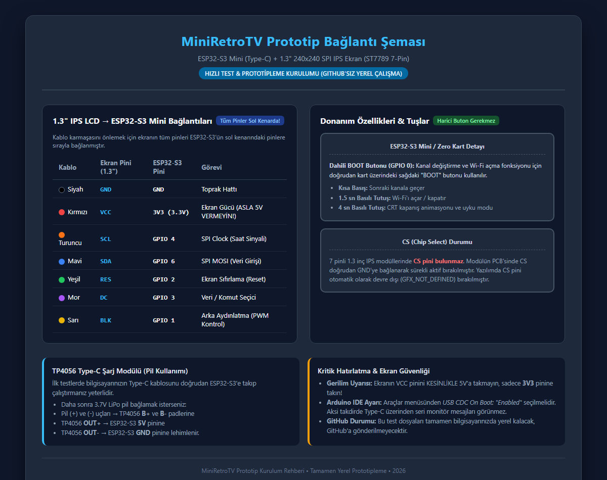

# 📺 Mini Retro TV — Montaj ve Çizim Rehberi

Bu rehberde hem **1.3" ST7789 ekran + ESP32-S3 ile yapılan çalışan test montajının** hem de 16GB MicroSD, amfi, hoparlör ve voltaj yükseltici şarj kartını içeren **nihai tam donanım montajının** detaylı çizimleri ve 3D kasa yerleşimleri yer almaktadır.

---

## 1. ⚡ Şu Anki Prototip Test Montajı (1.3" IPS + ESP32-S3 Mini)

Elinizdeki parçalarla lehim yapmadan veya breadboard/jumper kablo ile doğrudan test edebilmeniz için hazırlanan bağlantı çizimi:

  

### 📌 Montaj ve Bağlantı Tablosu

Kablo geçişlerini kolaylaştırmak ve karmaşayı önlemek için ekranın tüm pinleri **ESP32-S3'ün sol kenarındaki pin sırasına** birebir eşleştirilmiştir:

| Ekran Pini (1.3" IPS) | ESP32-S3 Mini Pini | Kablo | Açıklama |
| :--- | :--- | :--- | :--- |
| **GND** | **GND** | Siyah | Ortak toprak hattı |
| **VCC** | **3V3** (3.3V) | Kırmızı | ⚠️ **Sadece 3.3V'a bağlayın. Asla 5V vermeyin!** |
| **SCL** | **GPIO 4** | Turuncu | SPI Clock (Saat) |
| **SDA** | **GPIO 6** | Mavi | SPI MOSI (Görüntü verisi) |
| **RES** | **GPIO 2** | Yeşil | Reset pini |
| **DC** | **GPIO 3** | Mor | Data/Command pini |
| **BLK** | **GPIO 1** | Sarı | PWM Arka Aydınlatma Kontrolü (%70 Varsayılan) |
| *(CS Pini)* | *(Yok)* | — | 7 pinli modüllerde CS pini PCB üzerinde GND'ye bağlıdır. |

> [!TIP]
> **Buton Montajı Gerekmez:** ESP32-S3 Mini kartının sağ üst köşesinde bulunan dahili **BOOT** butonu (`GPIO 0`) yazılımda doğrudan kanal değiştirme / ses kapatma butonu olarak tanımlanmıştır. Test aşamasında harici bir buton lehimlemenize gerek yoktur.

---

## 2. 🔌 Nihai Tam Donanım Şeması (1.3" Ekran + MicroSD + Amfi + Boost Şarj)

Tüm donanım bir araya getirildiğinde (1.3" ST7789 Ekran + ESP32-S3 + 16GB MicroSD + MAX98357A I2S Amfi + TP4056 5V Boost Kartı + Hoparlör + 3.7V Li-Po Pil) kullanılacak tam montaj şeması:

  

### Alternatif 1.69" Kompakt Donanım Şeması (ESP32-C3 SuperMini)

  

---

## 3. 🖨️ 3D Baskı Kasa Montaj Çizimleri

3D yazıcıdan basılan kasanın parçaları ve montaj yerleşimi:

### Ön Kasa (Ekran Çerçevesi + Hoparlör Izgarası + Buton Delikleri)

  

### Arka Kapak (Type-C Soket Girişi + Havalandırma Kanalları)

  

### İç Montaj Plakası (Modülleri Sabitleme Kızağı)

  

---

### 🛠️ Kasa İçi Montaj Sırası:
1. **Ekran Yerleşimi:** 1.3" ekran ön paneldeki yuvasına oturtulur (Sol tarafta bırakılan 10 mm boşluk kablo dönüşlerini rahatlatır).
2. **Kanal Butonu:** Üstteki basmalı buton yerine yerleştirilir.
3. **Kart Kızakları:** ESP32 kartı ve şarj modülü iç plakadaki tırnaklara oturtulur.
4. **Hoparlör & Pil:** Hoparlör ön ızgara arkasındaki yuvaya, Li-Po pil ise alt bölmeye yerleştirilir.
5. **Kapak Kapanışı:** Arka kapak tırnaklı geçme yapısıyla bastırılarak vida gerektirmeden kilitlenir.
