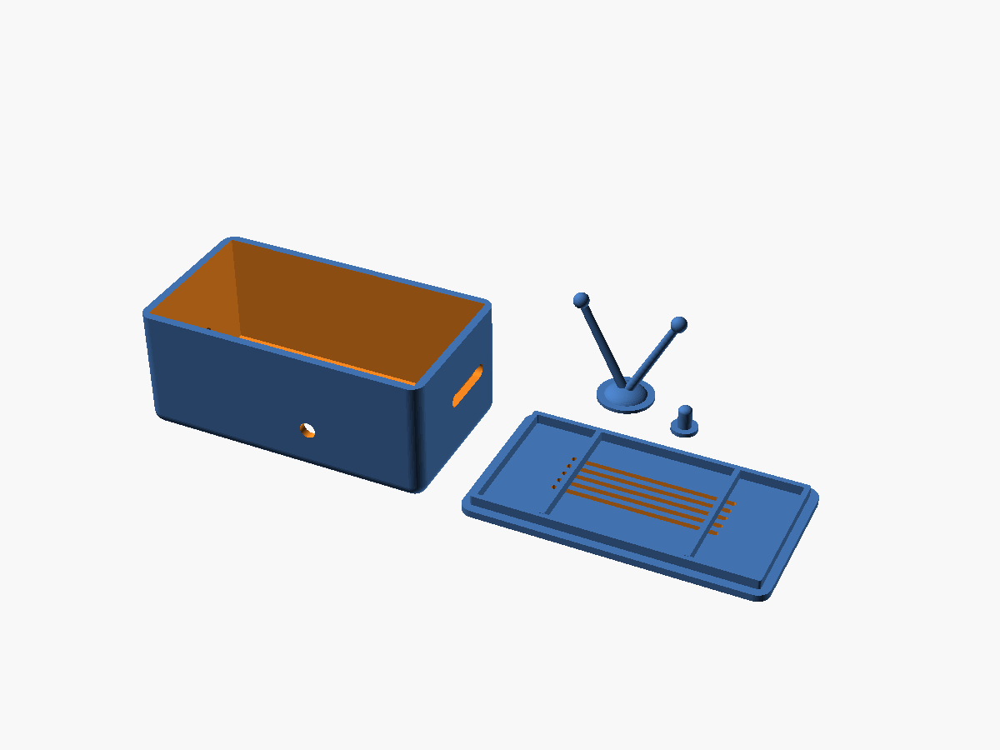

# 📺 Mini Retro TV
### (ESP32-S3 / C3 | 1.3" & 1.69" IPS ST7789 | 16GB MicroSD | I2S 3W Ses | 25 FPS Akıcı Video Motoru | Wi-Fi Web Arayüzü)

Figür ve diorama rafları için avuç içi / masaüstü boyutunda, **canlı IPS ekranlı**, **16GB MicroSD kart destekli**, **DMA tamponlu 25 FPS akıcı video motorlu**, **I2S 3W berrak ses çıkışlı** ve tarayıcı üzerinden otomatik medya dönüştürüp yükleyen kablosuz retro televizyon projesi.

<p align="center">
  
  
  
</p>

---

## 🌟 Öne Çıkan Özellikler

1. **🎬 Çift Donanımsal SPI & 25 FPS Kesintisiz Video Motoru:**
   - **FSPI Veriyolu (TFT Ekran):** 40 MHz hızında, DMA destekli donanımsal veri aktarımı.
   - **HSPI Veriyolu (MicroSD Kart):** 20 MHz bağımsız hat; SPI CS çakışması tamamen ortadan kaldırılmıştır.
   - **4096 Bayt Bellek Tamponu (Chunk-Buffered):** SD karttan okuma gecikmelerini ve takılmaları önleyerek pürüzsüz 25 FPS video akışı sunar.

2. **🔊 Gerçek Zamanlı I2S Ses & MUTE Yönetimi (120 ms DMA Tamponu):**
   - **Kesintisiz Ses Akışı:** 120 ms ön-tamponlu (pre-buffer) continuous audio motoru sayesinde video kareleri değişirken çıtırtı veya ses kopması yaşanmaz.
   - **Web Panelinden Kontrol:** %0 – %100 kaydırıcı, tek tıkla **MUTE (Sessize Al)** ve hızlı ses kademeleri (%0, %25, %50, %75, %100).
   - **Fiziksel Buton Kontrolü:**
     - **Tek Tık:** Sonraki video/kanala geçiş.
     - **Çift Tık (Hızlı 2 Basış):** **SESİ AÇ / KAPAT (MUTE TOGGLE)!**
     - **Uzun Basış (>1.2 sn):** Kademeli ses seviyesi döngüsü (%0 $\rightarrow$ %25 $\rightarrow$ %50 $\rightarrow$ %75 $\rightarrow$ %100).
   - **Tüplü TV OSD Göstergesi:** Ses değiştiğinde veya sessize alındığında ekranda 1.8 saniye boyunca canlı `[ 🔇 SES KAPALI (MUTE) ]` veya `[ 🔊 SES: %75 ██████▒▒ ]` retro çubuğu belirir (titreşimsiz / flicker-free).
   - **Kalıcı NVS Hafıza:** Cihaz kapatılıp açılsa bile son ses düzeyi ve sessiz modu otomatik hatırlanır.

3. **✨ Tarayıcıdan Tek Tıkla Fotoğraf & Video (+Ses) Yükleme:**
   - Bilgisayara harici program veya FFmpeg kurmaya gerek yoktur!
   - Tarayıcınız Web Audio API kullanarak videonun sesini otomatik olarak **16 kHz 16-bit Mono PCM** formatına dönüştürür, görüntüyü MJPEG olarak ölçekler ve SD karta eşzamanlı yazar.
   - **Kopmayan Parçalı Yükleme (Chunked 128 KB):** Büyük videolar 128 KB parçalarla yüklenir; Wi-Fi sinyali zayıflasa bile kaldığı yerden devam eder, kartta bozuk 0 bayt dosya bırakmaz.
   - **WakeLock Desteği:** Yükleme sırasında telefon veya bilgisayarınızın ekranı kapansa dahi aktarım kesilmez.

4. **📶 Akıllı Wi-Fi Yönetimi, Ev Ağına Bağlanma & mDNS:**
   - **AP Modu (Varsayılan):** `CollectibleDisplay` ağına şifresiz bağlanıp doğrudan `http://192.168.4.1` arayüzüne girebilirsiniz.
   - **Ev Wi-Fi (STA Çift Mod):** Web panelinden çevredeki 2.4 GHz Wi-Fi ağlarını tarayıp ev/ofis ağınıza bağlayabilirsiniz.
   - **mDNS Kolay Erişim:** Ev ağındayken IP aramak yerine `http://collectibletv.local` adresiyle doğrudan cihaza ulaşabilirsiniz.

5. **🖨️ %100 Desteksiz Yenilenen 3D Kasa (Yekpare V-Anten ile):**
   - **Yekpare 3D Basılabilir V-Anten:** Tel veya ataş gerektirmeyen, $62^\circ$ açılı ve desteksiz basılan retro V-anten tasarımı.
   - **Tek Tablada Hepsi (`plate.stl`):** Gövde, arka kapak, 2 adet çevirme düğmesi, 4 adet konik ayak ve yekpare V-anten tek seferde, tabla üzerinde **hiçbir destek (support) gerektirmeden** basılır.
   - **Çift Ekran Desteği:** OpenSCAD kaynak dosyasında (`display_type = "1.3"` veya `"1.69"`) tek parametreyle istenilen ekran boyutuna göre derlenebilir.

---

## 1. 📦 Donanım ve Malzeme Listesi

| Parça | Tercih Edilen Model | Alternatif Model | Açıklama / Görev |
|---|---|---|---|
| **Ana İşlemci** | **ESP32-S3 SuperMini** | ESP32-C3 SuperMini / S3 Mini | Çift çekirdek 240 MHz, Wi-Fi, Çift Donanımsal SPI, I2S |
| **Ekran** | **1.3" IPS 240×240 (ST7789, 8-Pin)** | 1.69" IPS 240×280 (ST7789, 8-Pin) | Canlı renkler, geniş IPS görüş açısı, donanımsal SPI |
| **Ses Amfisi** | **MAX98357A I2S 3W Class-D (7-Pin)** | - | Dahili DAC, gürültüsüz dijital I2S 16 kHz ses |
| **Hoparlör** | **8Ω 1W 20mm Mini Hoparlör** | 4-8Ω 14×20mm Mini Hoparlör | Ön ızgara yuvasına tam oturan akustik sürücü |
| **Depolama** | **16GB MicroSD Kart + SPI Modülü** | 8GB - 32GB MicroSD | Onlarca video ve fotoğraf için harici depolama |
| **Şarj & Güç** | **TP4056 Type-C Korumalı Şarj Kartı** | - | Li-Po bataryayı güvenli şarj etme & deşarj koruması |
| **Voltaj Yükseltici**| **MT3608 veya Mini 5V Boost Devresi** | Mini DC-DC 5V Step-Up | Li-Po voltajını amfi ve SD kart için 5.0V'a sabitler |
| **Batarya** | **3.7V 600–1200 mAh Li-Po (603035 / 703048)** | 3.7V 500mAh+ Li-Po | 2.5 – 4 saat kesintisiz taşınabilir çalışma süresi |
| **Kasa** | **3D Baskı (Parametrik OpenSCAD)** | - | 65.9 × 36.4 × 29.3 mm dış ölçüler, tırnaklı vidasız montaj |

* 🛒 **Hazır Satın Alma Sepeti:** [SATIN_ALMA_LISTESI.md](SATIN_ALMA_LISTESI.md) *(Doğrudan Hepsiburada sepet bağlantıları)*
* 📋 **Ayrıntılı Pin Tablosu:** [BAGLANTI_SEMASI.md](BAGLANTI_SEMASI.md)
* 🛠️ **Görsel Montaj Kılavuzu:** [MONTAJ_VE_BAGLANTI_REHBERI.md](MONTAJ_VE_BAGLANTI_REHBERI.md)

---

## 2. 🔌 Doğrulanmış Devre Şeması & Hayati Güvenlik Kuralları

Cihazınızı güvenle çalıştırmak ve bileşenlerin zarar görmesini engellemek için test edilmiş bağlantı şemasını uygulayınız:

<p align="center">
  
</p>

### ⚠️ HAYATİ GÜVENLİK VE MONTAJ KURALLARI (DİKKATLE OKUYUN!)
> [!CAUTION]
> **KURAL 1: MAX98357A Amfi Pin 4 (GAIN) ve Pin 5 (SD) KESİNLİKLE BOŞ BIRAKILMALIDIR!**  
> Pin 4 ve Pin 5'e hiçbir kablo lehimlemeyin, birbirine bağlamayın veya GND/VCC'ye köprülemeyin! Bu pinler boş kaldığında çip otomatik olarak dahili 9 dB kazanç ve L+R mono mix modunda güvenle çalışır. Köprüleme yapılması entegrenin kapanmasına (shutdown), aşırı akım çekip ısınmasına veya yanmasına sebep olabilir!

> [!WARNING]
> **KURAL 2: Ekrana Asla 5V Vermeyin!**  
> ST7789 IPS ekranın VCC pini kesinlikle ESP32-S3'ün `3.3V` çıkışına bağlanmalıdır. Ekrana 5V verilmesi ekran sürücüsünü anında yakar.  
> *Buna karşılık, MicroSD kart modülü üzerindeki dahili regülatörün (AMS1117-3.3) sağlıklı çalışabilmesi için MicroSD modülünün VCC pini `5V` hattına bağlanmalıdır.*

> [!IMPORTANT]
> **KURAL 3: USB Programlama Esnasında Harici 5V Boost Çıkışını Kesin!**  
> ESP32'yi bilgisayarın Type-C portuna bağlayıp kod yüklerken, harici Li-Po yükselticinin (5V Boost) çıkışını ESP32'nin 5V pinine aynı anda vermeyin. İki farklı 5V kaynağı çakışarak bilgisayar portuna veya yükselticiye zarar verebilir (ya da araya bir Schottky diyot ekleyin).

---

### Pin Bağlantı Listesi

#### 1. IPS ST7789 Ekran (8-Pin SPI - FSPI Veriyolu)
* **GND** $\rightarrow$ `GND`
* **VCC** $\rightarrow$ `3.3V` *(⚠️ Kesinlikle 3.3V)*
* **SCL** $\rightarrow$ `GPIO 4`
* **SDA** $\rightarrow$ `GPIO 6`
* **RES** $\rightarrow$ `GPIO 2`
* **DC**  $\rightarrow$ `GPIO 3`
* **CS**  $\rightarrow$ `GPIO 5` *(veya doğrudan GND)*
* **BLK** $\rightarrow$ `GPIO 1` *(PWM Ekran Parlaklığı)*

#### 2. 16GB MicroSD Kart Modülü (6-Pin SPI - HSPI Veriyolu)
* **VCC** $\rightarrow$ `5V (5U)` *(Dahili 3.3V regülatör için 5V şarttır)*
* **GND** $\rightarrow$ `GND`
* **CS**  $\rightarrow$ `GPIO 10`
* **MOSI** $\rightarrow$ `GPIO 11`
* **SCK** $\rightarrow$ `GPIO 12`
* **MISO** $\rightarrow$ `GPIO 13`

#### 3. MAX98357A I2S 3W Ses Amfisi (7-Pin)
* **1. LRC**  $\rightarrow$ `GPIO 8` *(Word Select Clock)*
* **2. BCLK** $\rightarrow$ `GPIO 7` *(Bit Clock)*
* **3. DIN**  $\rightarrow$ `GPIO 9` *(Data In)*
* **4. GAIN** $\rightarrow$ **BOŞ (Bağlanmaz!)**
* **5. SD**   $\rightarrow$ **BOŞ (Bağlanmaz!)**
* **6. GND**  $\rightarrow$ `GND`
* **7. VIN**  $\rightarrow$ `5V (5U)` *(Tam 3W ses gücü için 5V besleme)*
* **Hoparlör Klemensleri (`+` / `−`)** $\rightarrow$ 8Ω 1W Mini Hoparlör

#### 4. Güç & Şarj Katı
* **Li-Po Pil $\rightarrow$ TP4056 (B+ / B-)**
* **TP4056 Çıkışı (OUT+ / OUT-) $\rightarrow$ 5V Boost Girişi (IN+ / IN-)**
* **5V Boost Çıkışı (OUT+) $\rightarrow$ ESP32-S3 `5V (5U)` & MicroSD & Amfi** *(Trimpottan multimetreyle 5.0V'a ayarlayın)*
* **5V Boost Çıkışı (OUT-) $\rightarrow$ Sistem Ortak `GND`**

---

## 3. 🖨️ 3D Baskı Rehberi & STL Dosyaları

Tüm parçalar standart FDM 3D yazıcılarda (Bambu Lab, Creality Ender 3, Prusa vb.) tek seferde ve **destek (support) gerektirmeden** basılacak şekilde optimize edilmiştir:

<p align="center">
  
</p>

### 📦 STL Dosya Listesi (`enclosure/stl/`)

| Parça | STL Dosyası | Açıklama & Baskı Özellikleri |
|---|---|---|
| **Tek Tablada Hepsi** | [plate.stl](enclosure/stl/plate.stl) | **Tüm parçalar tek seferde baskı tablasında** (Gövde + Arka Kapak + Düğmeler + Ayaklar + **Yekpare V-Anten** + **Buton Pimi**). %100 Desteksiz! |
| **Buton Basma Pimi** | [button_cap.stl](enclosure/stl/button_cap.stl) | Kasa üstü 3.6 mm delikten dışarı düşmeyen, parmakla basılan T-şekilli buton başlığı. |
| **Yekpare V-Anten** | [antenna_solid.stl](enclosure/stl/antenna_solid.stl) | Tel/ataş gerektirmeyen, doğrudan 3D basılabilen desteksiz sağlam V-anten. |
| **Ana Gövde** | [body.stl](enclosure/stl/body.stl) | Ön yüzü tablaya basar. Sol tarafta 1 cm kablo dönüş payı, hoparlör ızgarası ve 3.6 mm buton deliği bulunur. |
| **Arka Kapak** | [back.stl](enclosure/stl/back.stl) | Vidasız tırnaklı kilit, Type-C şarj girişi ve soğutma kanalları. |
| **Düğmeler (2 Adet)**| [knobs.stl](enclosure/stl/knobs.stl) | Ön panel dekoratif retro çevirme düğmeleri. |
| **Ayaklar (4 Adet)** | [legs.stl](enclosure/stl/legs.stl) | TV'yi yukarı açılı tutan retro konik ayaklar. |
| **Tel Yuvalı Anten** | [antenna.stl](enclosure/stl/antenna.stl) | Geleneksel tel/ataş çubuk takmak isteyenler için alternatif boncuklu yuva. |
| **Kaynak CAD Kodu** | [mini_retro_tv.scad](enclosure/mini_retro_tv.scad) | Parametrik OpenSCAD modeli (`display_type = "1.3"` veya `"1.69"` seçilebilir). |

### ⚙️ Önerilen Dilimleyici (Slicer) Ayarları
* **Katman Yüksekliği (Layer Height):** `0.16 mm` – `0.20 mm`
* **İç Dolgu (Infill):** `%15` – `%20` (Gyroid veya Grid)
* **Destek (Supports):** **KAPALI / Destek Gerekmez** *(Tüm parçalar tabla düzlemine düz basar)*
* **Brim / Kenarlık:** Yekpare anten için isteğe bağlı 3-4 hat inner brim açılabilir.
* **Malzeme:** PLA / PLA+ veya PETG (~35 gram filament)
* **Baskı Süresi:** Standart hızda yaklaşık 1.5 – 2 saat

---

## 4. 💻 Firmware & Kod Yükleme Rehberi (Arduino IDE)

### 1. Kart Yöneticisi ve FQBN
Arduino IDE `Boards Manager` üzerinden **esp32 by Espressif Systems** paketini (v2.0.11 veya üzeri) yükleyin.

* **Seçilecek Kart:** `ESP32S3 Dev Module`
* **FQBN:** `esp32:esp32:esp32s3`

### 2. Arduino IDE Menü Ayarları
* **USB CDC On Boot:** `Enabled` *(Seri port çıktısını ve otomatik yüklemeyi aktif eder)*
* **Flash Size:** `4MB` (veya `8MB` / `16MB`)
* **Partition Scheme:** `Huge APP (3MB No OTA / 1MB SPIFFS)`
* **PSRAM:** `OPI PSRAM` (Kartınızda PSRAM varsa) veya `Disabled`
* **Upload Speed:** `921600`

### 3. Gerekli Kütüphaneler
Arduino Kütüphane Yöneticisi'nden aşağıdaki kütüphanelerin güncel sürümlerini kurun:
1. **TJpg_Decoder** (Bodmer) - Hızlı MJPEG kare kod çözücü
2. **ESP32-audioI2S** (schreibfaul1) - MAX98357A I2S ses motoru
3. **ArduinoJson** (Benoît Blanchon) - v6.x veya v7.x

### 4. Kodu Yükleme
`firmware/MiniRetroTV/MiniRetroTV.ino` dosyasını Arduino IDE ile açın, ESP32-S3'ün bağlı olduğu COM portunu seçin ve **Upload** butonuna basın.

---

## 5. 🌐 Kablosuz Web Arayüzü & Medya Yükleme

1. Cihaza güç verdiğinizde **`CollectibleDisplay`** Wi-Fi erişim noktası yayınlanır.
2. Telefon veya bilgisayarınızdan bu ağa bağlanın *(Şifresiz / Açık Ağ)*.
3. Tarayıcınızdan **`http://192.168.4.1`** adresini açın.
4. **Medya Yükleme:**
   - Bilgisayar veya telefonunuzdan herhangi bir **MP4, MOV, WEBM** video veya resim dosyasını sürükleyip bırakın.
   - Tarayıcınız videonun sesini Web Audio API ile otomatik olarak ayıklar (16 kHz PCM), görüntüyü 240×240 MJPEG yapar ve SD karta yükler.
   - Yükleme tamamlandığında TV otomatik olarak yeni medyayı kesintisiz oynatmaya başlar!
5. **Ev Wi-Fi Ağına Bağlanma:**
   - Web panelinden Wi-Fi sekmesine geçip evinizin 2.4 GHz ağını seçin ve şifrenizi kaydedin.
   - Artık telefonunuzun Wi-Fi ağını değiştirmeden ev ağınızdan **`http://collectibletv.local`** adresiyle televizyona ulaşabilirsiniz.

---

## 6. 🎮 Fiziksel Buton & OSD Kontrolleri

> [!TIP]
> **Fiziksel Buton Montaj Rehberi:**  
> ESP32 kartı üzerindeki lehimli minik SMD butonu kasanın üst deliğine milimetrik denk getirmek zordur ve kart kayarsa takılı kalabilir. Bunun yerine kasanın üstündeki 3.6 mm deliğin hemen altına **6×6 mm mini mikro tactile buton** yerleştirilip karta 2 ince kabloyla bağlanır:
> * **1. Bacak** $\rightarrow$ **ESP32-S3 `GPIO 0`** (BOOT pini)
> * **2. Bacak** $\rightarrow$ **ESP32-S3 `GND`** (Ortak toprak)
> * **Direnç Gerekmez:** Yazılımda dahili pull-up (`INPUT_PULLUP`) devrededir. Üzerine 3D basılan **`button_cap.stl`** pimi takılarak çıt-çıt parmakla rahatça basılır.

| Buton Hareketi | Tetiklenen Eylem | Ekran Göstergesi (OSD) |
|---|---|---|
| **Tek Tık** | Sonraki kanala/videoya geçiş | Kanal numarası ve dosya adı |
| **Çift Tık (Hızlı 2 Basış)** | **SESİ AÇ / SESSİZE AL (MUTE TOGGLE)** | `[ 🔇 SES KAPALI (MUTE) ]` veya `[ 🔊 SES: %... ]` |
| **Uzun Basış (>1.2 saniye)** | Ses seviyesi kademeleri arasında geçiş | `%0 ➔ %25 ➔ %50 ➔ %75 ➔ %100` grafik çubuğu |

* **Kalıcı Hafıza (NVS):** Ayarlanan ses seviyesi ve MUTE durumu cihaz kapatılıp açılsa bile saklanır.
* **Titreşimsiz (Flicker-Free) OSD:** OSD göstergesi video oynarken ekranın üst kısmında belirdiğinde video akışında takılma veya ekran yırtılması oluşturmaz.

---

## 7. 🛠️ Proje Dizin Yapısı

```
mini-retro-tv/
├── README.md                      # Proje ana tanıtımı ve eksiksiz rehber
├── BAGLANTI_SEMASI.md             # Doğrulanmış ayrıntılı pin bağlantı tablosu
├── SATIN_ALMA_LISTESI.md          # Doğrudan Hepsiburada sepet satın alma bağlantıları
├── MONTAJ_VE_BAGLANTI_REHBERI.md  # Adım adım montaj ve donanım güvenlik rehberi
│
├── enclosure/                     # 3D Baskı ve CAD kaynak dosyaları
│   ├── mini_retro_tv.scad         # Parametrik OpenSCAD modeli (1.3" / 1.69" seçilebilir)
│   ├── preview.png                # Kasa montajlı ön önizleme görseli
│   ├── preview_back.png           # Kasa arka kapak önizleme görseli
│   ├── preview_plate.png          # Baskı tablası yerleşim görseli
│   └── stl/                       # %100 Desteksiz 3D Baskı STL Dosyaları
│       ├── plate.stl              # TÜM PARÇALAR TEK TABLADA (Yekpare anten dahil)
│       ├── antenna_solid.stl      # Yekpare desteksiz V-anten
│       ├── body.stl               # Ana TV gövdesi
│       ├── back.stl               # Arka kapak (Type-C ve havalandırma kanallı)
│       ├── knobs.stl              # 2 adet ön dekoratif çevirme düğmesi
│       ├── legs.stl               # 4 adet retro konik TV ayağı
│       └── antenna.stl            # Alternatif tel/ataş anten yuvası ve boncuklar
│
├── docs/                          # Şemalar ve görsel dokümantasyon
│   ├── baglanti_semasi_13inch.png # Doğrulanmış 1.3 inç IPS devre şeması
│   ├── baglanti_semasi.png        # Alternatif 1.69 inç devre şeması
│   └── baski_tablasi.png          # Yüksek çözünürlüklü baskı tablası şeması
│
├── firmware/                      # Kaynak yazılım
│   └── MiniRetroTV/               # Arduino IDE projesi
│       ├── MiniRetroTV.ino        # 25 FPS video ve kesintisiz DMA ses motoru
│       ├── config.h               # Pin haritası, ekran ve ses ayarları
│       └── web_page.h             # Web Audio API dönüştürücülü kablosuz web paneli
│
├── sample_media/                  # Test amaçlı örnek MJPEG videolar
│   ├── korku_filmi_ornegi.mjpeg
│   └── ornek_retro_animasyon.mjpeg
│
└── tools/                         # Harici PC dönüştürme betikleri (İsteğe bağlı)
    ├── video_donusturucu.py
    └── video_donusturucu.bat
```

---

## 📜 Lisans & Teşekkür
Bu proje açık kaynaklıdır (MIT Lisansı). Diorama, figür ve retro teknoloji tutkunları için sevgiyle geliştirilmiştir.  
Katkıda bulunmak için Pull Request gönderebilir veya [Issues](../../issues) bölümünden soru sorabilirsiniz.
