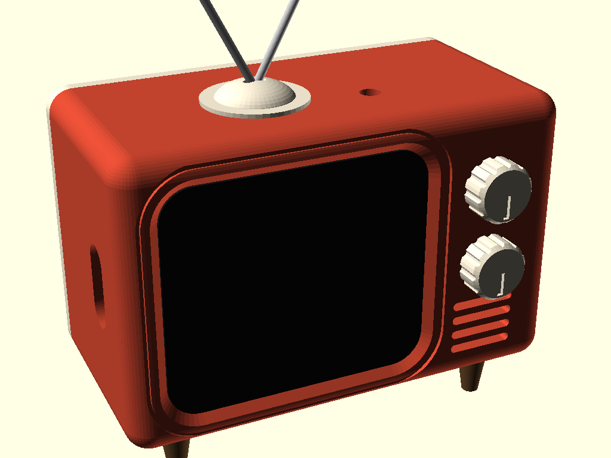
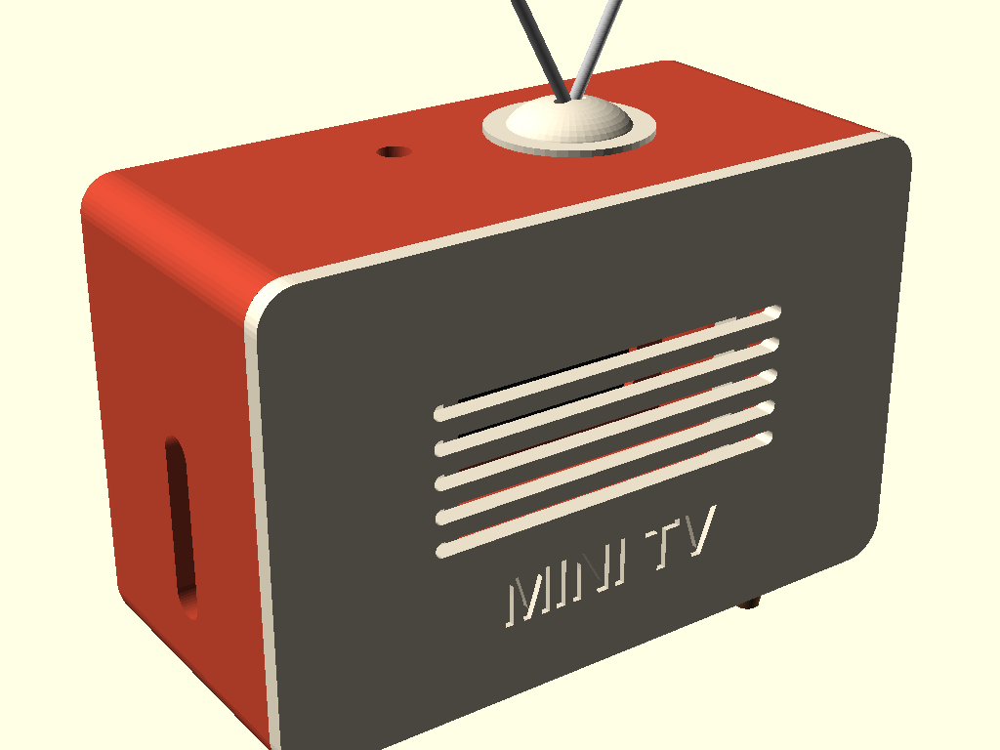

# 📺 Mini Retro TV (Sesli, MicroSD'li, Şarjlı, Wi-Fi Video Yüklemeli)

Figür ve diorama rafları için **55.9 × 36.2 × 28.3 mm** (gerçek derin tüplü CRT oranında, avuç içi/saat boyutunda) tam renkli, **gerçek sesli**, **MicroSD kartlı**, şarjlı ve kablosuz video yüklenebilen retro televizyon projesi.

  
  

  

---

## 1. Donanım Seti

| Parça | Seçilen Model | Görevi |
|---|---|---|
| **Ekran** | **1.69" 240×280 SPI IPS TFT LCD (ST7789, 8-pin)** | Yuvarlak köşeli canlı IPS ekran (gerçek tüplü TV görünümü) |
| **Wi-Fi Beyin** | **ESP32-C3 SuperMini (Lehimsiz)** | 18 × 22.5 mm, Wi-Fi, 4 MB Flash, Type-C |
| **Ses Sistemi** | **MAX98357A I2S 3W Dijital Amfi + 8Ω 1W Mini Hoparlör** | Video sesleri + kanal değişiminde gerçek retro TV cızırtısı |
| **Depolama** | **SPI MicroSD Kart Modülü** *(takılı değilse dahili hafıza)* | Gigabaytlarca çizgi film / dizi / film klibi |
| **Şarj & Pil** | **TP4056 Type-C Korumalı + 3.7V 600 mAh LiPo (603035)** | Tek şarjla ~4–6 saat sesli oynatma |
| **Kasa & Anten** | **3D Baskı (~20g PLA) + 1 adet metal ataş** | Destek (support) ve vida gerektirmez, açık ön hoparlör ızgaralı |

👉 **Satın Alma Linkleri:** [SATIN_ALMA_LISTESI.md](SATIN_ALMA_LISTESI.md)  
👉 **Tam Pin Bağlantı Şeması & Montaj:** [BAGLANTI_SEMASI.md](BAGLANTI_SEMASI.md)

---

## 2. Proje Dosyaları

* **3D Kasa (`enclosure/`):**
  * [mini_retro_tv.scad](enclosure/mini_retro_tv.scad) — Parametrik OpenSCAD tasarımı (ön hoparlör ızgarası açık, sağ yanda MicroSD yuvası, sol yanda USB-C şarj yuvası)
  * **Baskıya Hazır STL Dosyaları (`enclosure/stl/`):**
    * [body.stl](enclosure/stl/body.stl) — Ana gövde *(ön yüzü tablaya yatık, destek/support gerektirmez)*
    * [back.stl](enclosure/stl/back.stl) — Havalandırma yarıklı, geçmeli arka kapak
    * [knobs.stl](enclosure/stl/knobs.stl) — 2 adet tırtıklı retro kanal/ses düğmesi
    * [legs.stl](enclosure/stl/legs.stl) — 4 adet konik retro ayak
    * [antenna.stl](enclosure/stl/antenna.stl) — Tavşan kulağı anten tabanı + 2 uç boncuğu
    * [plate.stl](enclosure/stl/plate.stl) — Tüm parçalar tek baskı tablasında
* **Yazılım (`firmware/MiniRetroTV/`):**
  * [MiniRetroTV.ino](firmware/MiniRetroTV/MiniRetroTV.ino) — Senkronize MJPEG video + 16 kHz PCM ses oynatıcı, MicroSD + LittleFS otomatik destek, CRT açılış/kapanış efekti, sesli karlanma paraziti, yeşil `CH1` OSD
  * [config.h](firmware/MiniRetroTV/config.h) — Tüm pin, ekran, ses ve Wi-Fi ayarları
  * [web_page.h](firmware/MiniRetroTV/web_page.h) — Tarayıcı içinde MP4'ün hem görüntüsünü hem sesini dönüştürüp yükleyen + parlaklık ve ses seviyesi ayarlı web paneli
* **PC Video+Ses Dönüştürücü (`tools/`):**
  * [convert_to_mjpeg.bat](tools/convert_to_mjpeg.bat) — Uzun videoları sürükle-bırak ile `.mjpeg` + `.pcm` dosyalarına çevirip doğrudan MicroSD kartın `/v/` klasörüne atmak için

---

## 3. Kullanım Özeti

* **Buton (`BOOT` / GPIO 9):**
  * **Kısa bas:** Karlanma görüntüsü + cızırtı sesi + yeşil `CH1 / CH2` yazısıyla sonraki kanala geçer *(TV uykudaysa CRT efektiyle uyandırır)*.
  * **1.5 sn basılı tut:** Pil tasarrufu için Wi-Fi'ı açar/kapatır.
  * **4 sn basılı tut:** CRT kapanış çizgisiyle TV'yi kapatır / uyku moduna alır.
* **Web Arayüzü (`http://192.168.4.1` veya `http://minitv.local`):**
  * Ekran parlaklığı + **Ses Seviyesi (%0–100)** ayarı
  * Telefondan seçilen MP4 videolarının hem görüntüsünü hem sesini ekstra uygulama olmadan TV'ye gönderme
