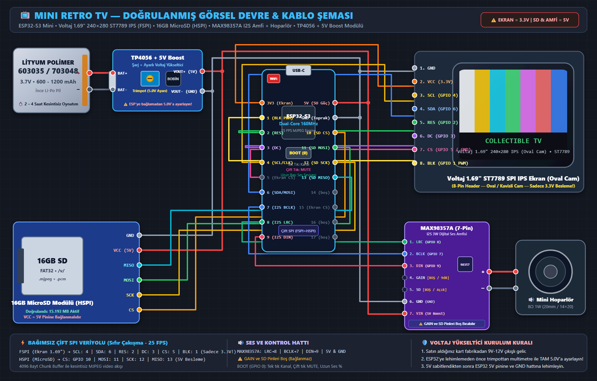
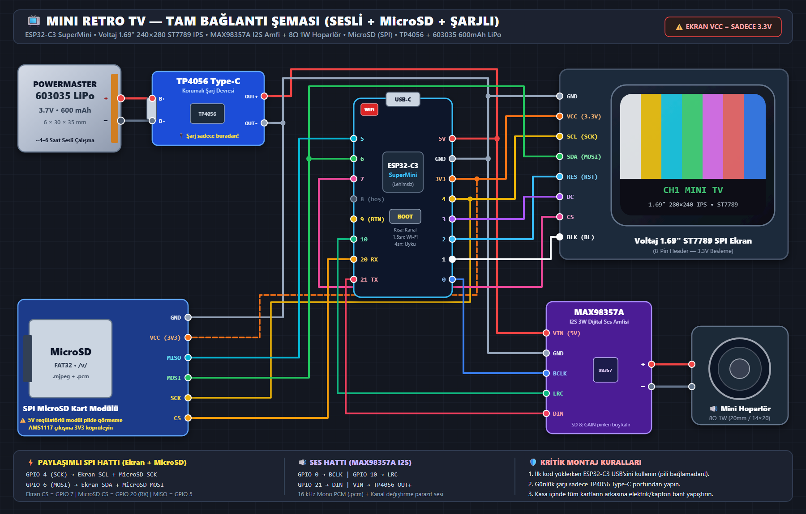

# 📺 Mini Retro TV (Voltaj 1.69" IPS ST7789, 16GB MicroSD, Wi-Fi Otomatik Medya Yüklemeli, 25 FPS)

Figür ve diorama rafları için avuç içi / masaüstü boyutunda, **Voltaj 1.69" 240×280 IPS canlı oval ekranlı**, **16GB MicroSD kart destekli**, **25 FPS akıcı video oynatıcılı**, kablosuz web panelli retro televizyon projesi.

<p align="center">
  
  
</p>

---

## 🌟 Öne Çıkan Özellikler

1. **🎬 Çift SPI & 25 FPS Akıcı Video Motoru:**
   - Ekran `FSPI` (GPIO 4, 6, 2, 3, 5, 1) veriyolunda 30 MHz hızında çalışır.
   - 16GB MicroSD modülü bağımsız `HSPI` (GPIO 10, 11, 12, 13) veriyolunda çalışır; CS çakışması sıfıra indirilmiştir.
   - 4096 baytlık RAM tamponlu (chunk-buffered) okuma motoru sayesinde takılma olmadan pürüzsüz 25 FPS oynatım sağlar.

2. **🔊 Gerçek Zamanlı Ses Kontrolü, Kısma ve Kapatma (MUTE):**
   - **Web Panelinden Kontrol:** %0 – %100 ses kaydırıcısı, tek tıkla **"Sesi Kapat (MUTE)"** butonu ve hızlı ses kademeleri (%0, %25, %50, %75, %100).
   - **Fiziksel Buton Kontrolü (Cihaz Üzerinden):**
     - **Tek tık:** Sonraki kanala/videoya geçiş.
     - **Çift tık (hızlı 2 basış):** **SESİ AÇ / KAPAT (MUTE TOGGLE)!**
     - **Uzun basış (>1.2 sn):** Ses kademeleri arasında geçiş (%0 $\rightarrow$ %25 $\rightarrow$ %50 $\rightarrow$ %75 $\rightarrow$ %100).
   - **Tüplü TV OSD Göstergesi (On-Screen Display):** Ses seviyesi değiştiğinde veya sessize alındığında ekranda 1.8 saniye boyunca canlı `[ 🔇 SES KAPALI (MUTE) ]` veya `[ 🔊 SES: %70 ████▒▒▒▒ ]` retro çubuğu belirir.
   - **Kalıcı Hafıza (NVS):** Cihaz kapatılıp açılsa bile son ses seviyesi ve mute durumu otomatik hatırlanır.

3. **✨ Tarayıcıdan Tek Tıkla Fotoğraf & Video (+Ses) Yükleme (Kesintisiz Parçalı Yükleme):**
   - Herhangi bir ek programa veya FFmpeg komutlarına ihtiyaç yoktur!
   - **Kopmayan Parçalı Yükleme Motoru (Chunked Upload):** Büyük videolar (10-50 MB) 128 KB'lık parçalara ayrılarak yüklenir; Wi-Fi sinyali dalgalansa bile otomatik olarak kaldığı parçadan devam eder, bağlantı kopmaz ve SD kartta 0 bayt bozuk dosya kalmaz.
   - Ekran uykusunu engelleyici (WakeLock) sayesinde telefon veya bilgisayarın ekranı kapansa dahi dönüştürme ve yükleme duraksamaz.
   - MP4, MOV, WEBM seçildiğinde tarayıcı Web Audio API ile videonun sesini 16 kHz mono PCM formatına ayıklar, görüntüyü 280×240 MJPEG yapar ve ikisini senkronize şekilde SD karta aktarır.

4. **📶 Wi-Fi Yönetimi, Ev Ağına Bağlanma ve Fabrika Ayarları:**
   - **Cihaz Hotspot Şifresi Değiştirme:** Panel üzerinden cihazın AP şifresi kolayca değiştirilebilir (Kalıcı NVS hafızada saklanır).
   - **Ev / Ofis Wi-Fi Ağına Bağlanma (STA Çift Mod):** Tek tıkla çevredeki 2.4 GHz Wi-Fi ağlarını tarar, şifrenizi girerek cihazı ev ağınıza bağlar.
   - **mDNS Desteği:** Ev ağınıza bağlandığınızda telefonunuzun Wi-Fi'ını değiştirmeden doğrudan `http://collectibletv.local` adresinden televizyon paneline ulaşabilirsiniz.
   - **Fabrika Ayarlarına Sıfırlama:** İstenildiğinde tek tıkla tüm Wi-Fi şifreleri ve ayarlar varsayılana sıfırlanabilir.

5. **🖨️ Yenilenen 3D Kasa (1.69" Oval Ekran ve 1200 mAh Pil Uyumlu):**
   - Voltaj 1.69" ST7789 ekranın 8-pin header ve kablo dönüşleri için sol taraftan **1 cm (10 mm) genişletildi** (`pcb_w = 59.0 mm`, toplam dış genişlik `65.9 mm`).
   - Ekran penceresi 1.69" oval ekran için `32.8 × 28.2 mm` ve `r = 4.0 mm` kavisli/oval köşe olarak hassas ayarlandı.
   - Arka kapak derinliği 1200 mAh Powermaster 703048 LiPo pil için optimize edildi.
   - Geçmeli kapak tasarımı sayesinde vidaya ihtiyaç duymaz.

---

## 1. Donanım Özeti

| Parça | Model | Görevi / Açıklama |
|---|---|---|
| **Ekran** | **Voltaj 1.69" 240×280 SPI IPS TFT (ST7789, 8-pin)** | 240×280 piksel, oval / kavisli cam, geniş açılı IPS panel |
| **İşlemci Kartı** | **ESP32-S3 Mini / ESP32-C3 SuperMini** | Çift çekirdek / Wi-Fi / Bluetooth, çift donanımsal SPI desteği |
| **Ses Amfisi** | **MAX98357A I2S 3W Class-D (7-pin)** | Dahili DAC, 16 kHz kristal netliğinde mono ses çıkışı |
| **Hoparlör** | **8Ω 1W 20mm Mini Hoparlör** | Ön ızgara arkasına tam oturan minyatür hoparlör |
| **Pil & Güç** | **1200 mAh Li-Po (703048) + TP4056 + MT3608 (5V Boost)** | ~3.5 – 4 saat kesintisiz video oynatım süresi |
| **Depolama** | **16GB MicroSD Kart Modülü (SPI)** | Onlarca saat video ve yüzlerce fotoğraf hafızası |
| **Kasa** | **3D Baskı (OpenSCAD Parametrik)** | 1 cm kablo paylı, 65.9 × 36.6 × 29.8 mm |

👉 **Orijinal Satın Alma Listesi:** [SATIN_ALMA_LISTESI.md](SATIN_ALMA_LISTESI.md) *(Doğrudan Hepsiburada sepet bağlantıları)*  
👉 **Ayrıntılı Pin Bağlantı Tablosu:** [BAGLANTI_SEMASI.md](BAGLANTI_SEMASI.md)  
👉 **Görsel Montaj ve Bağlantı Rehberi:** [MONTAJ_VE_BAGLANTI_REHBERI.md](MONTAJ_VE_BAGLANTI_REHBERI.md)

---

## 2. 🔌 Doğrulanmış Çalışan Pin Bağlantıları (Voltaj 1.69" ST7789 + ESP32-S3)

<p align="center">
  
</p>

### Ekran (Voltaj 1.69" ST7789 8-Pin - FSPI Veriyolu - Sol Pin Sırası)
* **1. GND** $\rightarrow$ `GND`
* **2. VCC** $\rightarrow$ `3.3V` *(⚠️ Asla 5V vermeyin!)*
* **3. SCL** $\rightarrow$ `GPIO 4`
* **4. SDA** $\rightarrow$ `GPIO 6`
* **5. RES** $\rightarrow$ `GPIO 2`
* **6. DC**  $\rightarrow$ `GPIO 3`
* **7. CS**  $\rightarrow$ `GPIO 5` *(veya GND)*
* **8. BLK** $\rightarrow$ `GPIO 1` *(PWM Parlaklık Kontrolü)*

### 16GB MicroSD Kart Modülü (HSPI Veriyolu - Sağ Pin Sırası)
* **VCC** $\rightarrow$ **`5V (5U)`** *(Dahili AMS1117 regülatörün sağlıklı çalışması için 5V şarttır)*
* **GND** $\rightarrow`GND`
* **CS**  $\rightarrow`GPIO 10`
* **MOSI** $\rightarrow`GPIO 11`
* **SCK** $\rightarrow`GPIO 12`
* **MISO** $\rightarrow`GPIO 13`

### MAX98357A I2S 3W Ses Amfisi & Hoparlör (7-Pin Modül)
* **1. LRC** $\rightarrow$ `GPIO 8` *(Left/Right Word Clock)*
* **2. BCLK** $\rightarrow$ `GPIO 7` *(Bit Clock)*
* **3. DIN** $\rightarrow$ `GPIO 9` *(Data In / Ses Verisi)*
* **4. GAIN** $\rightarrow$ **BOŞ (Bağlanmaz)** *(Varsayılan 9 dB temiz kazanç)*
* **5. SD** $\rightarrow$ **BOŞ (Bağlanmaz)** *(Varsayılan Açık / Mono birleştirme)*
* **6. GND** $\rightarrow$ `GND`
* **7. VIN** $\rightarrow$ **`5V (5U)`** *(3W tam ses çıkış gücü için 5V besleme)*
* **`+` / `−` (Hoparlör Klemens)** $\rightarrow$ 8Ω 1W Mini Hoparlör (+ Kırmızı, − Siyah)

### TP4056 + 5V Boost Voltaj Yükseltici & Li-Po Pil
* **BAT+ / BAT-** $\rightarrow$ 3.7V Li-Po Pil (603035 / 703048)
* **VOUT+** $\rightarrow$ ESP32-S3 `5V (5U)` *(⚠️ ESP32'ye bağlamadan önce trimpottan multimetreyle 5.0V'a ayarlayın!)*
* **VOUT-** $\rightarrow$ ESP32-S3 `GND`

---

### 🎨 Orijinal Alternatif Kompakt Sistem Şeması (1.69" + ESP32-C3 SuperMini)

<p align="center">
  
</p>

---

## 3. 🌐 Kablosuz Web Arayüzü Kullanımı

1. Cihaza güç verdiğinizde **`CollectibleDisplay`** Wi-Fi erişim noktası yayınlanır.
2. Telefon veya bilgisayarınızdan bu ağa bağlanın *(Şifresiz / Açık Ağ - İsteğe bağlı panelden şifre atanabilir)*.
3. Tarayıcınızda **`http://192.168.4.1`** adresine gidin.
4. Karşınıza gelen modern panelde:
   - 16GB SD kartınızın kalan ve kullanılan alanını canlı olarak görebilirsiniz.
   - Sürükle-bırak veya dosya seçici ile herhangi bir fotoğraf veya videoyu seçebilirsiniz.
   - Tarayıcınız görseli anında 240×240 boyutuna ölçekler ve SD karta yükler.
   - Yüklenen medya anında TV ekranında oynamaya başlar!
   - Alt kısımdaki listeden yüklü videolar arasında geçiş yapabilir veya silebilirsiniz.

---

## 4. 🖨️ 3D Baskı Dosyaları & Baskı Tablası (`enclosure/stl/`)

Tüm parçalar standart 3D yazıcı tablasında (Ender 3, Bambu Lab, Prusa vb.) tek seferde ve **destek (support) gerektirmeden** basılacak şekilde tasarlanmıştır:

<p align="center">
  
</p>

### 📦 STL Parça Listesi:
| Parça | STL Dosyası | Açıklama & Montaj Rolü |
|---|---|---|
| **Ana Gövde** | [body.stl](enclosure/stl/body.stl) | Ön yüzü tablaya basar. Sol tarafta 1 cm kablo geçiş payı ve hoparlör ızgarası bulunur. |
| **Arka Kapak** | [back.stl](enclosure/stl/back.stl) | Vidasız tırnaklı kilit sistemi, Type-C şarj girişi ve soğutma kanalları. |
| **Tek Tablada Hepsi** | [plate.stl](enclosure/stl/plate.stl) | **Tüm parçalar tek seferde baskı tablasında** (Gövde + Kapak + Düğmeler + Ayaklar + Anten). |
| **Düğmeler (2 Adet)** | [knobs.stl](enclosure/stl/knobs.stl) | Ön dekoratif retro çevirme düğmeleri. |
| **Ayaklar (4 Adet)** | [legs.stl](enclosure/stl/legs.stl) | TV'yi hafif yukarı açılı tutan retro konik ayaklar. |
| **Anten Yuvası & Boncuklar** | [antenna.stl](enclosure/stl/antenna.stl) | Ataş/tel takılarak gerçekçi retro TV anteni oluşturulur. |
| **Kaynak CAD Kodu** | [mini_retro_tv.scad](enclosure/mini_retro_tv.scad) | Parametrik OpenSCAD kaynak modeli (+10 mm sol paylı). |

### ⚙️ Önerilen Dilimleyici (Slicer) Ayarları:
* **Katman Kalınlığı (Layer Height):** `0.16 mm` – `0.20 mm`
* **İç Dolgu (Infill):** `%15` – `%20` (Gyroid veya Grid)
* **Destek (Supports):** **KAPALI / Gerekmez** *(Tüm parçalar tabla düzlemine göre optimize edilmiştir)*
* **Malzeme:** PLA / PLA+ veya PETG (~35 gram filament)
* **Baskı Süresi:** Standart hızda yaklaşık 1.5 – 2 saat

---

## 5. 🛠️ Proje Dizin Yapısı

```
mini-retro-tv/
├── BAGLANTI_SEMASI.md       # Ayrıntılı pin bağlantı rehberi
├── README.md                # Proje genel tanıtımı ve kullanım kılavuzu
├── SATIN_ALMA_LISTESI.md    # Korunan orijinal malzeme sepeti listesi
├── enclosure/               # 3D Baskı ve CAD kaynak dosyaları
│   ├── mini_retro_tv.scad   # OpenSCAD kaynak modeli (+10 mm sol paylı)
│   ├── preview.png          # Kasa ön görseli
│   ├── preview_back.png     # Kasa arka görseli
│   └── stl/                 # Baskıya hazır STL dosyaları (body, back, plate vb.)
├── firmware/
│   └── MiniRetroTV/         # Arduino IDE yazılımı
│       ├── MiniRetroTV.ino  # 25 FPS çift SPI video motoru
│       ├── config.h         # Pin tanımları ve ayarlar
│       └── web_page.h       # Otomatik fotoğraf/video dönüştürücülü web panel
├── sample_media/            # Örnek hazır MJPEG videolar
│   ├── korku_filmi_ornegi.mjpeg
│   └── ornek_retro_animasyon.mjpeg
└── tools/                   # PC dönüştürücü araçları (FFmpeg & Python)
    ├── video_donusturucu.py
    └── video_donusturucu.bat
```
